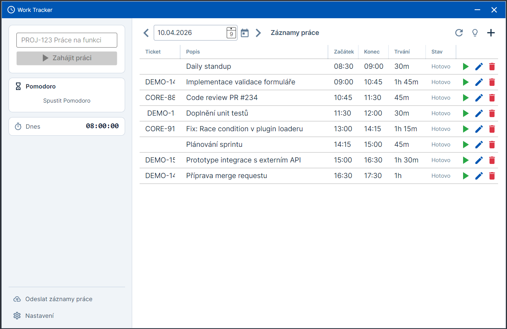

# WorkTracker

**English** | [Čeština](README.cs.md)

**A desktop time-tracking application with an extensible plugin system.**

[](https://github.com/vesnicancz/work-tracker/actions/workflows/dotnet.yml)
[](https://github.com/vesnicancz/work-tracker/releases/latest)
[](https://dotnet.microsoft.com/)
[](https://learn.microsoft.com/en-us/dotnet/csharp/)

[](https://learn.microsoft.com/en-us/ef/core/)
[](https://avaloniaui.net/)

---



## About

WorkTracker is a desktop application for tracking the time you spend on work items. It is built on .NET 10 with Clean Architecture and offers two ways to control it:

- **Avalonia GUI** — a modern cross‑platform interface (Windows, Linux, macOS)
- **CLI** — a terminal client (Spectre.Console) for quick use from the command line

The core of the application is extended through plugins, loaded into isolated `AssemblyLoadContext`s. The plugins for Jira, Tempo, Office 365 Calendar, Goran G3, the Luxafor LED indicator and Stream Deck are published as separate `WorkTracker-Plugin-*.zip` packages. They are not part of the application package: download the ones you need and extract them into the `plugins/` directory next to the executable (for the GUI on macOS, into `~/Library/Application Support/WorkTracker/plugins/`).

### Main features

- Start / stop / edit / delete work entries, with automatic detection of the Jira ticket code
- Daily overview with "Go to today" navigation, and worklog submission for a day or a week
- Worklog upload to external systems with a preview, a choice between timed and aggregated mode (total per day × ticket + description), and retry on failure
- Work Suggestions from Jira issues and calendar events
- Detection and resolution of overlapping time intervals (Unit of Work transactions)
- Pomodoro timer with OS notifications and an optional indication on a Luxafor LED
- Favorites as templates for a quick start
- System tray icon with click-to-toggle window and a quick menu
- Automatic update check
- Localization (Czech, English)

---

## Quick start

### Prerequisites

- [.NET 10.0 SDK](https://dotnet.microsoft.com/download/dotnet/10.0)
- Git
- One of the supported platforms: Windows 10/11, Linux or macOS (both the CLI and Avalonia are cross‑platform)

### Clone and build

```bash
git clone https://github.com/vesnicancz/work-tracker.git
cd work-tracker

dotnet restore
dotnet build
dotnet test
```

### Run from the source tree

```bash
# CLI (cross-platform)
dotnet run --project src/WorkTracker.CLI -- help

# Avalonia (cross-platform)
dotnet run --project src/WorkTracker.Avalonia
```

### Your first entry

```bash
dotnet run --project src/WorkTracker.CLI -- start PROJ-123 "Implementing a new feature"
dotnet run --project src/WorkTracker.CLI -- status
dotnet run --project src/WorkTracker.CLI -- stop
dotnet run --project src/WorkTracker.CLI -- list
```

A detailed guide to the first run and everyday use is in [docs/user-guide.md](docs/user-guide.md) (in Czech).

---

## CLI overview

| Command | Description |
|---------|-------------|
| `start [ticket] [description] [time]` | Start tracking work (auto‑stops the previous entry) |
| `stop [time]` | Stop the active entry |
| `status` | Show the currently running entry |
| `list [date]` | List the entries for a given day (default: today) |
| `edit <id> [--ticket=] [--start=] [--end=] [--desc=]` | Edit an existing entry |
| `delete <id>` | Delete an entry |
| `send [week] [date]` | Send the worklog to an external system (preview + confirmation). `--provider=<id>` selects a specific plugin, `--yes`/`-y` skips the confirmation |
| `providers` | List the worklog upload plugins and whether they are enabled |
| `version`, `help` | Version and help |

The output of `list`, `status` and `providers` can also feed scripts: `--json` prints JSON and `--plain` prints one entry per line, with TAB-separated columns and no header. When stdout goes to a pipe or a file, the CLI switches to `--plain` by itself, so `WorkTracker.CLI list | grep PROJ-123` just works. Details are in the [user guide](docs/user-guide.md#výstup-pro-skripty-a-pipe) (in Czech).

Examples:

```bash
# Start with a Jira code, a description and an explicit time
WorkTracker.CLI start PROJ-123 "Bug fix" 09:00

# Send the whole current week
WorkTracker.CLI send week

# Edit entry no. 5
WorkTracker.CLI edit 5 --ticket=PROJ-456 --end=17:30 --desc="New description"
```

> **How to run the binary:** The examples above show only the program name. In practice it depends on the platform and on whether the binary's folder is in your `PATH`:
>
> - **Windows**: `WorkTracker.CLI.exe start …` (from PowerShell / CMD), or `.\WorkTracker.CLI.exe start …` from the local folder
> - **Linux / macOS**: `./WorkTracker.CLI start …` from the local folder, or `WorkTracker.CLI start …` if it is in your `PATH`
>
> **macOS and the GUI:** On macOS, Avalonia is distributed as `WorkTracker-{version}-macos-arm64.dmg` — open it and drag `WorkTracker.app` to Applications. The signed bundle is not written to, so plugins don't belong there — they go to `~/Library/Application Support/WorkTracker/plugins/`. The build is only ad-hoc signed, so Gatekeeper blocks it on first launch. On macOS 15 and later, allow it in **System Settings → Privacy & Security → Open Anyway** (right-click → Open no longer works there), on older versions use **right-click → Open**, or on any version run `xattr -dr com.apple.quarantine /Applications/WorkTracker.app`. For details see [Installation](docs/user-guide.md#instalace) (in Czech).
>
> **A note on the help:** The built-in help (`WorkTracker.CLI help`) uses the historical name `worklog` in its usage strings (e.g. `Usage: worklog start [ticket-id] ...`). It is an old relic — the actual binary is called `WorkTracker.CLI`, so replace `worklog` with `WorkTracker.CLI` when calling it (with `.exe`/`./` depending on the platform).

The Jira ticket is detected automatically from the start of the input using the regex `^([a-zA-Z0-9]+-[0-9]+)` (there is no word boundary, so `PROJ-123abc` yields the ticket `PROJ-123` and the description `abc`) (verified in `JiraPatterns.TicketId()`). The prefix before the hyphen may contain letters and digits, and allows both upper and lower case (the character class `[a-zA-Z]`, not `RegexOptions.IgnoreCase`), but it **does not allow an underscore** — e.g. `PROJ-123` or `proj-123` work, `WORK_TRACKER-42` doesn't. Times can be entered as `HH:mm`, `HH:mm:ss` or `yyyy-MM-dd HH:mm`.

---

## Configuration

### Data location

The application stores all persistent data in `%LocalAppData%\WorkTracker\` (Windows), `~/.local/share/WorkTracker/` (Linux) or `~/Library/Application Support/WorkTracker/` (macOS).

> **Environment suffix:** When running in a non‑Production environment (the `DOTNET_ENVIRONMENT` or `ASPNETCORE_ENVIRONMENT` variable is not `Production`), a suffix is added to the folder name — `WorkTracker_Development` for development, and so on. A Debug build sets `Development` by itself if the variable isn't given (this applies to `dotnet run`, launching from an IDE and running the binary by hand), so settings, logs and `keys/` go to `%LocalAppData%\WorkTracker_Development\`. In Development the database is `worktracker-dev.db` next to the binary (see `appsettings.Development.json`). A Release build (a published binary without the environment variable overridden) uses plain `WorkTracker`.

Folder contents:

```
WorkTracker/
├── worktracker.db          # SQLite database (migrated automatically)
├── settings.json           # User settings (plugins, theme, Pomodoro…)
├── settings.json.bak       # Previous version of the settings
├── plugins/                # Plugins (only for the GUI on macOS in `.app`, elsewhere next to the executable)
├── logs/                   # Serilog (rolling daily, 14 files)
└── keys/                   # MSAL token cache (encrypted by the OS keystore by default; on some Linux installations it may fall back to an unencrypted cache — see the warning in the log)
```

A custom database path can be set in `appsettings.json`:

```json
{
  "Database": {
    "Path": "D:\\my-data\\worktracker.db"
  }
}
```

### Plugin settings

Plugins are configured directly in the GUI application (**Settings → Plugins**). Each plugin exposes a list of fields (`PluginConfigurationField`), for which the UI generates a matching form and validates the input.

The application stores sensitive data (API tokens, passwords) through `ISecureStorage` in the system credential store:

- **Windows** — Credential Manager (DPAPI)
- **macOS** — Keychain
- **Linux** — libsecret / GNOME Keyring (outside a desktop session you need to set `GCM_CREDENTIAL_STORE`)

`settings.json` holds only a placeholder `CS:{pluginId}:{fieldKey}` in their place, never plaintext. OAuth tokens for plugins using MSAL (Office 365 Calendar, Goran G3) live in an encrypted cache in `keys/`, and when the refresh token expires you need to sign in again through **Test Connection** (Office 365 Calendar in the browser, Goran G3 through the device code flow).

> **Plugins in the CLI:** `WorkTracker.CLI` reads the enabled state and the plugin configuration from the same `settings.json` as the GUI, so `send` works from the terminal too. The plugin itself must also be extracted into the `plugins/` folder next to the CLI. Plugins are enabled and configured only in the GUI (Avalonia → **Settings → Plugins**) — the CLI only uses them. `WorkTracker.CLI providers` shows what is currently available. Except for Stream Deck, the plugin docs in [docs/plugins/](docs/plugins/) include a sample `appsettings.json` schema of the plugin as a reference for integrators with their own host.

> **Security:** Do not commit API tokens to Git.

---

## Plugin system

WorkTracker supports four types of plugins:

| Type | Interface | Purpose |
|------|-----------|---------|
| **Worklog Upload** | `IWorklogUploadPlugin` | Uploading worklogs to external systems |
| **Work Suggestion** | `IWorkSuggestionPlugin` | Suggesting work items (issues, calendar events) |
| **Status Indicator** | `IStatusIndicatorPlugin` | Controlling physical status indicators (LEDs etc.) |
| **Remote Control** | `IRemoteControlPlugin` | Controlling the running application from external devices (Stream Deck etc.) |

### Bundled plugins

| Plugin | Description | Documentation |
|--------|-------------|---------------|
| **Atlassian** | Tempo worklog upload + Jira suggestions (shared `JiraClient`) | [docs/plugins/atlassian.md](docs/plugins/atlassian.md) |
| **Office 365 Calendar** | Work suggestions from calendar events (MSAL, sign-in in the browser) | [docs/plugins/office365-calendar.md](docs/plugins/office365-calendar.md) |
| **Goran G3** | Worklog upload through an MCP server with Entra ID authentication | [docs/plugins/goran-g3.md](docs/plugins/goran-g3.md) |
| **Luxafor** | Shows the Pomodoro phase on a Luxafor Bluetooth Pro LED | [docs/plugins/luxafor.md](docs/plugins/luxafor.md) |
| **Stream Deck** | Controls tracking from a Stream Deck + controller | [docs/plugins/stream-deck.md](docs/plugins/stream-deck.md) |

### Writing your own plugin

```csharp
using Microsoft.Extensions.Logging;
using WorkTracker.Plugin.Abstractions;

public sealed class MyPlugin : WorklogUploadPluginBase
{
    public MyPlugin(ILogger<MyPlugin> logger) : base(logger) { }

    public override PluginMetadata Metadata => new()
    {
        Id = "my.worklog",
        Name = "My Plugin",
        Version = new Version(1, 0, 0),
        Author = "Me",
    };

    public override IReadOnlyList<PluginConfigurationField> GetConfigurationFields() => [];

    public override Task<PluginResult<bool>> TestConnectionAsync(
        IProgress<string>? progress, CancellationToken ct) =>
        Task.FromResult(PluginResult<bool>.Success(true));

    public override Task<PluginResult<bool>> UploadWorklogAsync(
        PluginWorklogEntry worklog, CancellationToken ct)
    {
        // …your upload logic…
        return Task.FromResult(PluginResult<bool>.Success(true));
    }
}
```

The complete guide: [docs/plugin-development.md](docs/plugin-development.md) (in Czech).

---

## Architecture

Clean Architecture with one-way dependencies:

```
Avalonia (GUI: windows, ViewModels, Orchestrators, ISettingsService, ILocalizationService)
      └─ Application (IWorkEntryService, IUnitOfWork, Result<T>, DTOs)
            └─ Domain (WorkEntry, IWorkEntryRepository, business rules)

CLI ─> Application
Avalonia, CLI ─> Infrastructure (bootstrap only: AddInfrastructure, DB and plugin initialization)

Plugin.Abstractions (IPlugin, *PluginBase) — the common API for all plugins
      └─ referenced by Application (Infrastructure transitively) and the individual plugin projects
```

See [docs/architecture.md](docs/architecture.md) (in Czech) for the detailed diagram and a description of the layers and patterns (Result pattern, Unit of Work, plugin DI).

### Projects in the repository

```
work-tracker/
├── src/
│   ├── WorkTracker.Domain/               # Business entities and rules
│   ├── WorkTracker.Application/          # Use cases, services, interfaces
│   ├── WorkTracker.Infrastructure/       # EF Core, SQLite, PluginManager, MSAL
│   ├── WorkTracker.CLI/                  # Spectre.Console client
│   ├── WorkTracker.Avalonia/             # Avalonia GUI (cross-platform)
│   └── WorkTracker.Plugin.Abstractions/  # Plugin API
├── plugins/
│   ├── WorkTracker.Plugin.Atlassian/         # Tempo + Jira Suggestions
│   ├── WorkTracker.Plugin.Office365Calendar/ # O365 Calendar suggestions
│   ├── WorkTracker.Plugin.GoranG3/           # Goran G3 worklog upload
│   ├── WorkTracker.Plugin.Luxafor/           # Luxafor LED status
│   └── WorkTracker.Plugin.StreamDeck/        # Stream Deck, the WorkTracker side
├── streamdeck-plugin/                    # Stream Deck, the Stream Deck app side (TypeScript)
├── tests/                                # xUnit + Moq + FluentAssertions
└── docs/                                 # Documentation
```

---

## Documentation

The detailed documentation is currently available in Czech only.

- **[User guide](docs/user-guide.md)** — CLI and GUI tutorial, first run, troubleshooting
- **[Architecture](docs/architecture.md)** — layers, DI, Result pattern, Unit of Work
- **[Developer guide](docs/developer-guide.md)** — setup, build, tests, migrations, conventions
- **[Plugin development](docs/plugin-development.md)** — how to write your own plugin
- **[Plugins](docs/plugins/)** — configuration reference for the bundled plugins

---

## Contributing

1. Fork the repository
2. Create a feature branch (`git checkout -b feature/new-feature`)
3. Follow the coding standards ([docs/developer-guide.md](docs/developer-guide.md)) and add tests
4. Commit + push, then open a Pull Request against `master`

When reporting a bug, include the application version (`WorkTracker.CLI version`), the OS, the .NET version, the steps to reproduce and the logs from `%LocalAppData%\WorkTracker\logs\`.

## Contact

- [GitHub Issues](https://github.com/vesnicancz/work-tracker/issues)
